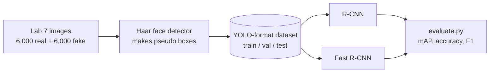
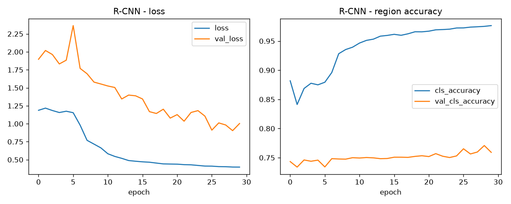
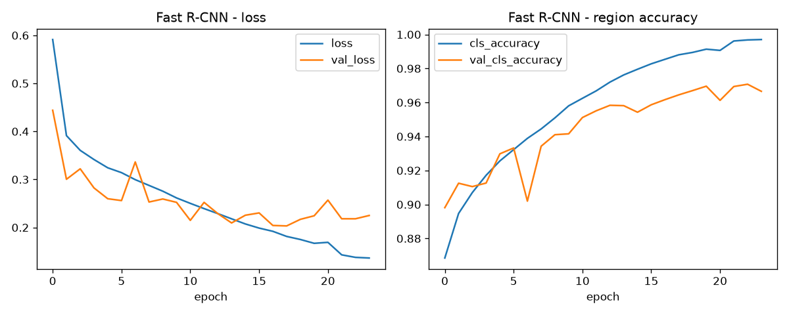
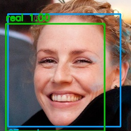
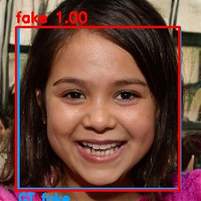
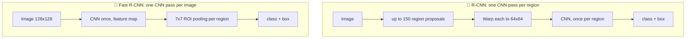

<div align="center">

# 🕵️ Real or Fake Face? Object Detection with R-CNN vs Fast R-CNN

**ML Lab 9 · Object Detection I** · Computer Engineering, RMUTT


-76B900?logo=nvidia&logoColor=white)


*Find the face. Then decide: is it **real** or **fake**?*

</div>

---

## ⚡ TL;DR

> [!IMPORTANT]
> **Fast R-CNN wins by a mile: 84.5% image accuracy vs 48.5% for R-CNN** (chance level).
> Both find the face box well, but only Fast R-CNN can tell real from fake.

| | 🐢 R-CNN | 🚀 Fast R-CNN |
|---|:---:|:---:|
| **mAP50** | 0.637 | **0.937** |
| **Image accuracy** | 0.485 | **0.845** |
| **F1 (macro)** | 0.327 | **0.844** |

---

## 🗺️ The big picture



> [!NOTE]
> **Why pseudo boxes?** Lab 7 only has real/fake labels, with no bounding boxes, and object
> detection needs boxes. `prepare_dataset.py` finds each face with an OpenCV Haar detector
> (10% margin). If no face is found, it falls back to a centered box that spans 90% of the image width and height.

---

## 📊 Results

Evaluated on **200 test images** (150 region proposals each). Both models were trained on the
full training split on an RTX 3050 6 GB (WSL2).

| Metric | R-CNN | Fast R-CNN |
|---|---|---|
| AP50 · real | 0.4492 | **0.9267** |
| AP50 · fake | 0.8251 | **0.9474** |
| **mAP50** | 0.6371 | **0.9370** |
| Mean IoU of matched boxes | 0.8238 | **0.8835** |
| **Image accuracy** | 0.4850 | **0.8450** |
| Precision (macro) | 0.2425 | **0.8470** |
| Recall (macro) | 0.5000 | **0.8438** |
| F1 (macro) | 0.3266 | **0.8443** |
| No-detection rate | 0.0 | 0.0 |

**At a glance** (each █ is 5 percentage points):

```text
Image accuracy
  R-CNN       ██████████░░░░░░░░░░  48.5%   (coin-flip territory)
  Fast R-CNN  █████████████████░░░  84.5%

mAP50
  R-CNN       █████████████░░░░░░░  63.7%
  Fast R-CNN  ███████████████████░  93.7%

Mean IoU x100 (how well the boxes fit)
  R-CNN       ████████████████░░░░  82.4%
  Fast R-CNN  ██████████████████░░  88.4%
```

### 📈 Training curves and sample outputs

| | R-CNN | Fast R-CNN |
|---|:---:|:---:|
| **Training curves** |  |  |
| **Sample detection** |  |  |

🟢 predicted real · 🔴 predicted fake · 🔵 reference (pseudo ground-truth) box

### 🔍 Reading the numbers honestly

- **R-CNN finds faces but cannot tell the classes apart.** Image accuracy is 0.485 (chance). Precision
  0.2425 is exactly half of 0.485 and recall is exactly 0.5, which is the signature of predicting the
  same class for (almost) every image. Its mAP50 of 0.64 mostly rewards finding the face box, so
  **image accuracy is the number to trust.**
- **R-CNN overfits.** In the last epoch shown, training region accuracy was 0.976 but validation
  region accuracy was only 0.759 (classification loss 0.83 on validation vs 0.07 on training).
- **Fast R-CNN generalizes.** Validation region accuracy 0.967 vs 0.997 on training data. (Region
  accuracy includes background regions, so it reads higher than image accuracy.)

> [!WARNING]
> **This is not a controlled experiment.** The two models also differ in input size (64 vs 128),
> depth and batch size, so the gap is not purely "R-CNN vs Fast R-CNN". A fair follow-up is to
> train R-CNN with larger crops (for example 128×128).

> [!TIP]
> **Likely reason (untested):** R-CNN warps every region to 64×64 and judges it alone, which probably
> destroys the fine texture that gives fake faces away. Fast R-CNN looks at the whole 128×128 image
> once and pools each region from the shared feature map.

---

## 🧠 How the two detectors work



Both share the same recipe: **region proposals** (multi-scale sliding windows, a cheap stand-in for
Selective Search) → label each region by IoU with the face box (≥ 0.5 = `real`/`fake`, < 0.3 =
`background`) → predict **class** (softmax) + **box refinement** → **score threshold + per-class NMS**.

| | 🐢 R-CNN | 🚀 Fast R-CNN |
|---|---|---|
| CNN input | each region warped to 64×64 | whole image at 128×128 |
| CNN passes per image | one per region (up to 150; 131 for a square image) | **1** |
| Region feature | CNN output of the crop | 7×7 pooling on the shared feature map (bilinear `crop_and_resize`, ROI-Align style) |
| Backbone | 3 conv blocks (32-64-128) + Dense 256 | same 3 blocks + 1 extra conv + ROI pool + Dense 256 |
| Training samples | 12 regions per image (~100,800 per epoch) | 32 regions per image, resampled every epoch |
| Batch | 64 regions | 16 images (512 regions) |

---

## 🚀 Quick start

> [!NOTE]
> Use **Python 3.12**. On Python 3.14, `pip` found no matching TensorFlow release (only a 2.22 release
> candidate). Use **OpenCV 4.x**: `requirements.txt` pins `opencv-python<5` because `opencv-python` 5.x
> has no `cv2.CascadeClassifier`, which the Haar face detector needs.

**1️⃣ Install**
```bash
python -m venv venv
source venv/bin/activate            # Windows: .\venv\Scripts\Activate.ps1
pip install -r requirements.txt
```

**2️⃣ Build the dataset** from Lab 7 (folder names must contain "real" / "fake")
```bash
python prepare_dataset.py --data-dir "C:\Users\NITRO V15\Documents\ML\ML-07-CNN\ML-07-CNN\DATASET"
# quick subset: add  --max-per-class 1500
```
Creates `dataset/{train,val,test}` with a stratified 70/15/15 split (seed 42):
**8,400 train · 1,800 val · 1,800 test** (full dataset, no `--max-per-class`). Haar hit/fallback counts: `dataset/prepare_report.json`.

**3️⃣ Train and evaluate** (run inside `01-R-CNN/` or `02-Fast-R-CNN/`)
```bash
python train.py --limit 0 --epochs 30           # --limit 0 = all training images
python evaluate.py --limit 200 --split test     # writes outputs/evaluation.json
```

**4️⃣ Try it**
```bash
python image_test.py                            # random test image -> outputs/image_result.jpg
python image_test.py --image path/to/face.jpg   # your own image
python realtime_test.py --camera 0 --threshold 0.85 --regions 25   # webcam, press Q to quit
```

Training uses early stopping (patience 6, best weights restored) and learning-rate reduction, and
saves `model.keras`, `history.json` and `training_curves.png` in `outputs/`.

---

## 🗂️ Project structure

```text
ML-09-Object_Detection_I/
├── 📄 common.py               shared: dataset reading, IoU, proposals, NMS, box coding, mAP
├── 📄 prepare_dataset.py      Lab 7 DATASET -> dataset/ (YOLO format)
├── 📁 01-R-CNN/               train · evaluate · image_test · realtime_test · outputs/
├── 📁 02-Fast-R-CNN/          train · evaluate · image_test · realtime_test · outputs/
├── 📄 requirements.txt
└── 📄 README.md
```

---

<details>
<summary><b>📐 What each metric means (<code>evaluation.json</code>)</b></summary>

| Key | Meaning |
|---|---|
| `AP50`, `mAP50` | box IoU ≥ 0.5 **and** correct class (VOC all-point AP) |
| `mean_IoU_of_matched` | average overlap of correct detections with the reference boxes |
| `image_accuracy` | class of the highest-scoring detection vs the image's real/fake label |
| `no_detection_rate` | images where nothing passed the score threshold (counted as wrong) |
| `precision_macro`, `recall_macro`, `f1_macro` | image-level, macro-averaged over real/fake |

</details>

<details>
<summary><b>🛠️ Troubleshooting (GPU / WSL2)</b></summary>

| Problem | Fix |
|---|---|
| GPU out of memory with `--limit 0` | Already handled: crops are stored as uint8 and sent to the GPU batch by batch. If it still happens, lower `--batch`. |
| `CropAndResize ... XLA_GPU_JIT` error | XLA cannot compile `CropAndResize` (used for ROI pooling). `jit_compile=False` is set in Fast R-CNN's `make_model` and in `load_model` of both models. |
| `cv2 has no attribute CascadeClassifier` | Wrong OpenCV: `pip install "opencv-python<5"` (use `opencv-python-headless<5` in WSL). |
| `externally-managed-environment` in WSL | `pip` is the system one. Use `python -m pip ...` with the venv's Python; if the venv has no pip, run `python -m ensurepip` first (or `uv pip install --python <venv python> ...`). |

</details>

<details>
<summary><b>⚠️ Limitations</b></summary>

- Reference boxes are pseudo-labels (Haar or the centered fallback), so IoU and AP measure
  agreement with those boxes, not with hand-drawn faces.
- The test set has 200 images, so image accuracy has roughly ±5 points of uncertainty.
- Proposals are sliding windows, not Selective Search, and there is no region proposal network
  (that is Faster R-CNN).
- Both backbones are small CNNs trained from scratch. A pretrained backbone (as in Lab 8) is the
  obvious next step to raise accuracy, especially for R-CNN.

</details>

---

## 📚 References

- [Rich feature hierarchies for accurate object detection (R-CNN)](https://arxiv.org/abs/1311.2524)
- [Fast R-CNN](https://arxiv.org/abs/1504.08083)