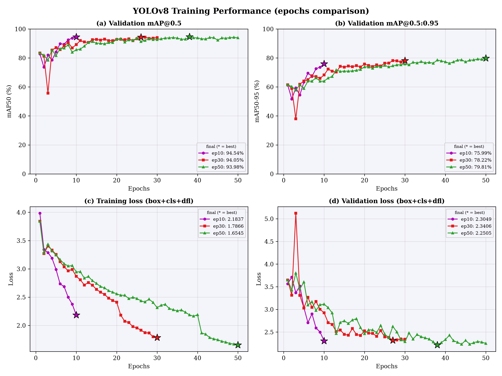
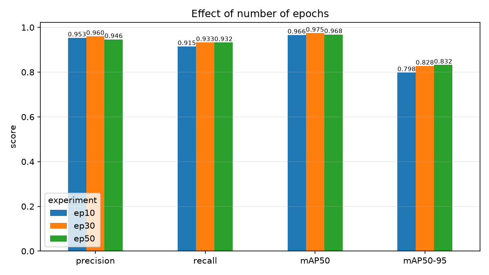
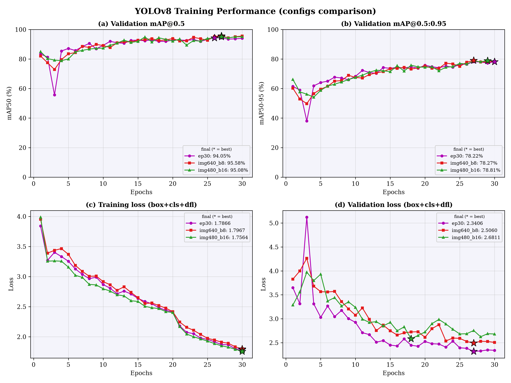
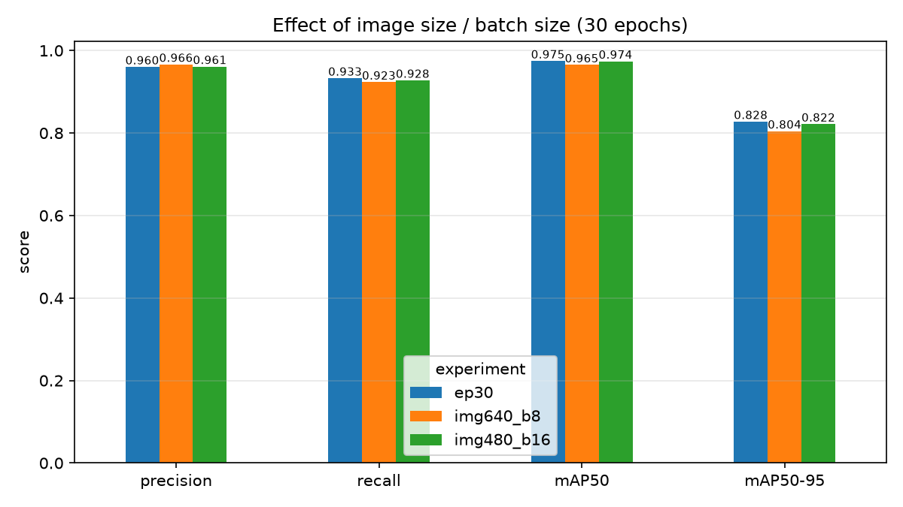
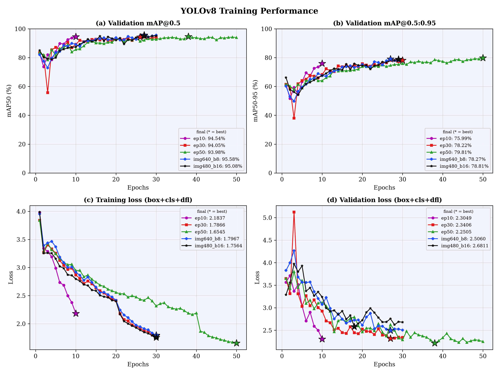
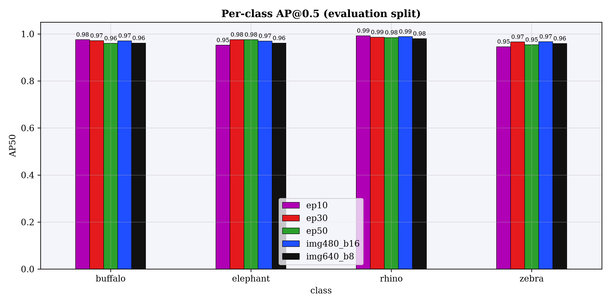
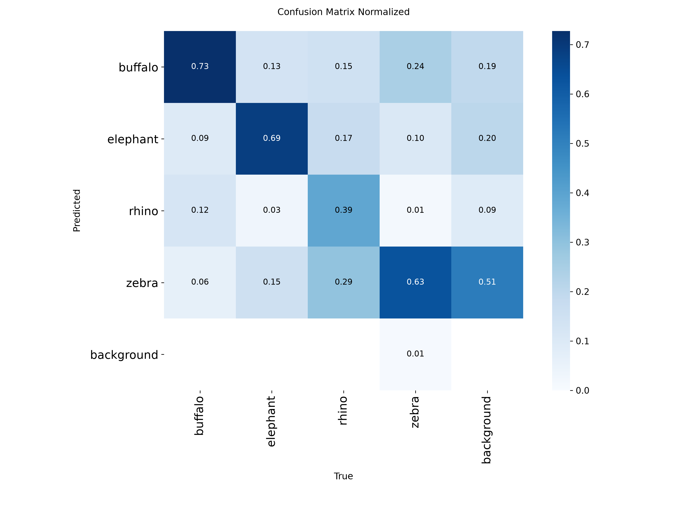
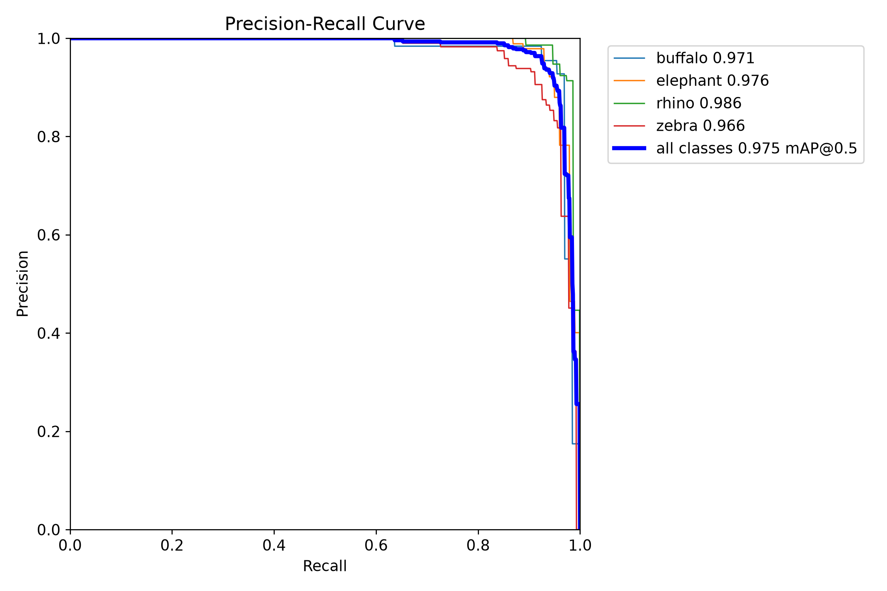

<div align="center">

# 🦓 ML-10 · Object Detection II
### Detecting African wildlife with YOLOv8 — and what changes when you train longer, bigger, or in larger batches


*Machine Learning (04-624-201) · Lab 10 · Rajamangala University of Technology Thanyaburi*

</div>

---

## ✨ At a glance

| | |
|---|---|
| **Model** | YOLOv8n fine-tuned from COCO-pretrained weights (3.0 M parameters, 8.2 GFLOPs) |
| **Dataset** | African Wildlife — 4 classes (buffalo, elephant, rhino, zebra), 1,504 images |
| **Experiments** | 5 configurations: 3 epoch budgets × 2 image/batch variations |
| **Best test result** | **mAP50 0.975** · mAP50-95 0.832 · Precision 0.966 · Recall 0.933 |
| **Speed** | ~5 ms inference per image · 23.4 FPS end-to-end on video |
| **Hardware** | NVIDIA RTX 3050 Laptop (6 GB) · WSL2 Ubuntu |

<details>
<summary><b>🇹🇭 สรุปภาษาไทย</b></summary>

ใบงานนี้ฝึกโมเดล YOLOv8n ให้ตรวจจับสัตว์ 4 ชนิด (ควายป่า ช้าง แรด ม้าลาย) แล้วเปรียบเทียบผล 5 รูปแบบการฝึก
คือ จำนวน epochs (10 / 30 / 50), ขนาดภาพ (480 / 640) และ batch size (8 / 16) ประเมินด้วย Precision, Recall และ mAP บนชุด test 227 รูป

**ข้อสรุปหลัก:** การเพิ่มจาก 10 เป็น 30 epochs ให้ผลดีขึ้นชัดเจน (mAP50-95 0.798 → 0.828) แต่จาก 30 เป็น 50 epochs แทบไม่ต่างกัน
ขนาดภาพ 640 ไม่ช่วยให้แม่นขึ้นแต่ช้าลงราว 29% ส่วน batch 16 ให้ผลใกล้เคียงกับ batch 8 — การตั้งค่าที่คุ้มที่สุดคือ **30 epochs, imgsz 480, batch 8**

</details>

## 📑 Contents

[1. Dataset](#1--dataset) · [2. Method](#2--method) · [3. Results](#3--results) · [4. Qualitative results](#4--qualitative-results) · [5. Analysis](#5--analysis) · [6. Limitations](#6--limitations) · [7. Reproduce](#7--reproduce-it) · [8. Project structure](#8--project-structure) · [9. References](#9--references)

---

## 1 · Dataset

[African Wildlife](https://docs.ultralytics.com/datasets/detect/african-wildlife/) (Ultralytics, YOLO format).

| Split | Images | Label files |
|---|---:|---:|
| Train | 1,052 | 1,052 |
| Validation | 225 | 225 |
| Test | 227 | 227 |

**Classes:** `0 buffalo` · `1 elephant` · `2 rhino` · `3 zebra`

The test split has ground-truth labels, so every number in [Results](#3--results) is measured on **images the model never saw during training or model selection**.
`download_dataset.py` fetches the data and writes `dataset/data.yaml`; `prepare_dataset.py --check` verifies the counts above.

## 2 · Method

All runs fine-tune `yolov8n.pt` and differ only in the settings below.

| Experiment | Epochs | Image size | Batch | Question it answers |
|---|---:|---:|---:|---|
| `ep10` | 10 | 480 | 8 | Baseline |
| `ep30` | 30 | 480 | 8 | Does more training help? |
| `ep50` | 50 | 480 | 8 | Is there still a gain after 30? |
| `img640_b8` | 30 | 640 | 8 | Does higher resolution help? |
| `img480_b16` | 30 | 480 | 16 | Does a larger batch help? |

**Shared settings:** AdamW optimizer with Ultralytics' automatic learning rate (0.00125), mixed precision (AMP), seed 0, default Ultralytics augmentations, best checkpoint chosen by validation fitness (`best.pt`).
Metrics are computed with `model.val()` on the **test** split at each experiment's own training image size.

## 3 · Results

### 3.1 Test-set performance

| Experiment | Precision | Recall | mAP50 | mAP50-95 | Inference |
|---|---:|---:|---:|---:|---:|
| `ep10` | 0.953 | 0.915 | 0.966 | 0.798 | 5.4 ms |
| `ep30` | 0.960 | **0.933** | **0.975** | 0.828 | **5.0 ms** |
| `ep50` | 0.946 | **0.933** | 0.968 | **0.832** | 5.2 ms |
| `img640_b8` | **0.966** | 0.923 | 0.965 | 0.805 | 6.5 ms |
| `img480_b16` | 0.961 | 0.928 | 0.974 | 0.822 | 5.5 ms |

<sub>Bold = best in column. Inference time is model-only (RTX 3050 Laptop) and varies by a few tenths of a millisecond between runs.</sub>

### 3.2 Effect of the number of epochs

<p align="center">
  
</p>

<p align="center">
  
</p>

### 3.3 Effect of image size and batch size

<p align="center">
  
</p>

<p align="center">
  
</p>

### 3.4 Training and validation loss

Panels (c) and (d) of each figure above show the summed box + classification + DFL loss per epoch (stars mark the best epoch).
Detailed precision / recall / per-term loss curves: `runs/summary/ieee_detail.png`. The raw per-epoch numbers are in `runs/exp_<name>/results.csv`.

<p align="center">
  
</p>

### 3.5 Per-class results (test split)

AP50-95 — the stricter metric — per class:

| Class | `ep10` | `ep30` | `ep50` | `img640_b8` | `img480_b16` |
|---|---:|---:|---:|---:|---:|
| buffalo | 0.836 | 0.855 | 0.856 | 0.834 | 0.843 |
| elephant | 0.760 | 0.794 | 0.815 | 0.753 | 0.778 |
| rhino | 0.880 | 0.901 | 0.899 | 0.881 | 0.893 |
| zebra | 0.717 | 0.760 | 0.759 | 0.750 | 0.773 |

<p align="center">
  
</p>

<table align="center">
  <tr>
    <td align="center"><br><sub>Normalized confusion matrix (<code>ep30</code>)</sub></td>
    <td align="center"><br><sub>Precision–recall curves (<code>ep30</code>)</sub></td>
  </tr>
</table>

## 4 · Qualitative results

### Images

Random test images, annotated with class label and confidence (`python image_test.py`). All five were classified correctly, with confidence between 0.92 and 0.94.

<table align="center">
  <tr>
    <td></td>
    <td></td>
    <td></td>
  </tr>
  <tr>
    <td align="center"><sub>rhino · 0.94</sub></td>
    <td align="center"><sub>rhino · 0.93</sub></td>
    <td align="center"><sub>zebra · 0.94</sub></td>
  </tr>
</table>

### Video

`python video_test.py --source zebra.mp4` processed **9,321 frames at 23.4 FPS** (`imgsz=640`, RTX 3050 Laptop). This figure covers the whole pipeline — decoding, inference, drawing boxes and writing the output file — so it is lower than the model-only speed in the table above.
The annotated output is written to `runs/video_test/`.

### Real-time camera

`realtime_test.py` is included for webcam / stream input, but real-time camera results are **not** part of the reported numbers.

## 5 · Analysis

**More epochs help — up to a point.** Going from 10 to 30 epochs raised mAP50-95 from 0.798 to 0.828 and recall from 0.915 to 0.933. Going on to 50 epochs added only 0.005 mAP50-95 while mAP50 and precision slipped slightly, so training had largely saturated by about 30 epochs.

**Higher resolution did not pay off.** `img640_b8` scored lower than `ep30` on mAP50-95 (0.805 vs 0.828) and was about 29% slower per image (6.5 ms vs 5.0 ms). A plausible reason is that the animals are large in most frames, so extra pixels add little information — this explanation was not tested directly.

**Batch size 16 vs 8 made little difference.** `img480_b16` landed within about 0.006 mAP50-95 of `ep30`. With the same number of epochs, a larger batch performs fewer weight updates, which may account for the small gap.

**Zebras are the hardest class; rhinos the easiest.** Zebra AP50-95 sits at 0.72–0.77 in every experiment even though it has the most test instances (135), while rhino reaches 0.88–0.90. One possible cause is that zebras often stand in overlapping herds with striped outlines that blur object boundaries — a hypothesis, not something these experiments verify.

**Recommended configuration:** `ep30` (30 epochs, 480 px, batch 8) — best mAP50, joint-best recall, and the fastest inference, at lower training cost than `ep50`.

## 6 · Limitations

- **Small test set.** With 227 images and 375 objects, differences of roughly one point between experiments are within noise. Each experiment was run once with a single seed, so only the larger effects (10 → 30 epochs) should be considered reliable.
- **Pretrained start.** COCO already contains elephants and zebras, which explains the high scores after only 10 epochs. The conclusions may not carry over to classes the base model has never seen.
- **Scope.** One dataset, one model size (YOLOv8n), and a learning rate chosen automatically rather than tuned.

## 7 · Reproduce it

```bash
# 1. environment (WSL2 / Linux, NVIDIA GPU)
python3 -m venv ~/venv-ml10 && source ~/venv-ml10/bin/activate
pip install -r requirements.txt
python -c "import torch; print(torch.cuda.is_available())"   # expect True

# 2. data
python download_dataset.py --name african-wildlife
python prepare_dataset.py --check

# 3. train, evaluate, plot
python train.py                 # all five experiments (skips finished ones, resumes interrupted ones)
python evaluate.py              # test-set metrics -> runs/summary/evaluation_summary.csv
python plot_results.py          # figures + results table -> runs/summary/

# 4. inference
python image_test.py --n 5
python video_test.py --source your_video.mp4
python realtime_test.py         # webcam / stream (see notes in the script)
```

<details>
<summary>Useful options</summary>

```bash
python train.py --exp ep10 ep30        # run only some experiments
python train.py --fraction 0.2         # train on 20 % of the images (quick test)
python train.py --force                # retrain even if finished
python evaluate.py --split val         # evaluate on the validation split
python image_test.py --weights runs/exp_ep50/weights/best.pt --conf 0.4
```

Keep the project inside the WSL filesystem (`~/`) rather than `/mnt/c` for faster image loading.
</details>

## 8 · Project structure

```text
ML-10-Object-Detection-II/
├── dataset/
│   ├── train/{images,labels}/
│   ├── val/{images,labels}/
│   ├── test/{images,labels}/
│   └── data.yaml
├── common.py             # shared paths + experiment definitions
├── download_dataset.py   # fetch a built-in Ultralytics dataset
├── prepare_dataset.py    # check / split a YOLO-format dataset
├── train.py              # train all experiments
├── evaluate.py           # Precision, Recall, mAP50, mAP50-95
├── plot_results.py       # loss curves, comparison charts, results table
├── image_test.py         # detection on images
├── video_test.py         # detection on a video file
├── realtime_test.py      # detection from a camera / stream
├── runs/
│   ├── exp_<name>/       # weights, results.csv, training plots
│   ├── evaluation/<name>/# confusion matrix, PR / F1 curves
│   ├── summary/          # tables and report figures
│   ├── image_test/       # annotated images
│   └── video_test/       # annotated video
├── requirements.txt
└── README.md
```

## 9 · References

- Jocher, G., Qiu, J., Chaurasia, A. — [Ultralytics YOLO](https://docs.ultralytics.com/models/yolov8/)
- [African Wildlife dataset](https://docs.ultralytics.com/datasets/detect/african-wildlife/) — Ultralytics
- Redmon, J. et al. (2016). *You Only Look Once: Unified, Real-Time Object Detection.* CVPR.